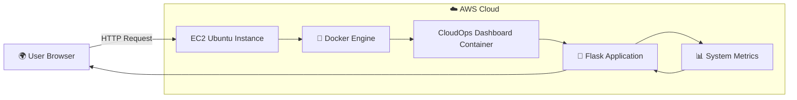
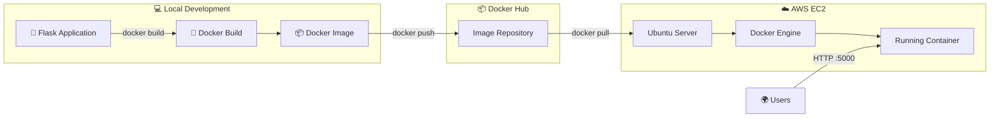

<div align="center">

# 🐳 CloudOps Monitoring Dashboard

Real-Time **System Monitoring Dashboard** built with **Python Flask**, containerized using **Docker**, published to **Docker Hub**, and deployed on **AWS EC2**.


> 🚀 A production-style CloudOps Monitoring Dashboard that collects real-time system metrics, runs inside a Docker container, is published to Docker Hub, and is deployed on AWS EC2.

</div>

---

# 📖 Overview

This project demonstrates a complete **containerized cloud deployment workflow** by building a real-time monitoring dashboard using **Python Flask**.

The application monitors system resources and displays them through an interactive dashboard while following modern DevOps practices.

The deployment pipeline includes:

* 🐍 Python Flask Application
* 📊 Live System Monitoring
* 🐳 Docker Containerization
* 📦 Docker Hub Image Registry
* ☁️ AWS EC2 Deployment
* 🐧 Linux Server Administration

---

# 📑 Table of Contents

* 📖 Overview
* 🏛️ Architecture
* 🔄 Deployment Workflow
* ✨ Features
* 🛠️ Technologies Used
* 📂 Project Structure
* ⚙️ Prerequisites
* 🚀 Quick Start
* 🐳 Docker Commands
* ☁️ AWS EC2 Deployment
* 📸 Screenshots
* 🎓 Learning Outcomes
* 📚 Skills Demonstrated
* 🎯 Resume Highlights
* 🚀 Future Improvements
* 📄 License
* 👨‍💻 Author

---

# 🏛️ Architecture



---

# 🔄 Deployment Workflow



---

# ✨ Features

* ✅ Real-Time CPU Monitoring
* ✅ Memory Usage Monitoring
* ✅ Disk Usage Monitoring
* ✅ Network Statistics
* ✅ Alert Logging
* ✅ Responsive Dashboard
* ✅ Docker Containerization
* ✅ Docker Hub Image Deployment
* ✅ AWS EC2 Hosting
* ✅ Linux Server Deployment

---

# 🛠️ Technologies Used

| Technology   | Purpose             |
| ------------ | ------------------- |
| Python       | Backend Development |
| Flask        | Web Framework       |
| psutil       | System Monitoring   |
| HTML5        | Dashboard UI        |
| CSS3         | Styling             |
| JavaScript   | Dynamic Charts      |
| Docker       | Containerization    |
| Docker Hub   | Image Registry      |
| AWS EC2      | Cloud Hosting       |
| Ubuntu Linux | Server OS           |
| Git          | Version Control     |
| GitHub       | Source Code Hosting |

---

# 📂 Project Structure

```text
cloudops-monitoring-dashboard/
│
├── static/
│   ├── css/
│   ├── js/
│   └── images/
│
├── templates/
│   └── index.html
│
├── screenshots/
│   ├── dashboard.png
│   ├── docker-build.png
│   ├── dockerhub.png
│   ├── ec2-instance.png
│   └── deployed-app.png
│
├── app.py
├── requirements.txt
├── Dockerfile
├── .dockerignore
├── .gitignore
├── README.md
└── start.sh
```

---

# ⚙️ Prerequisites

Before starting, ensure you have:

* Docker
* Docker Hub Account
* AWS Account
* EC2 Instance
* Git
* GitHub

---

# 🚀 Quick Start

### Clone Repository

```bash
git clone https://github.com/yourusername/cloudops-monitoring-dashboard.git

cd cloudops-monitoring-dashboard
```

### Build Docker Image

```bash
docker build -t cloudops-dashboard .
```

### Run Docker Container

```bash
docker run -d -p 5000:5000 --name cloudops cloudops-dashboard
```

### Open Application

```
http://localhost:5000
```

---

# 🐳 Docker Commands

### Build Image

```bash
docker build -t cloudops-dashboard .
```

### List Images

```bash
docker images
```

### Run Container

```bash
docker run -d -p 5000:5000 --name cloudops cloudops-dashboard
```

### Stop Container

```bash
docker stop cloudops
```

### Start Container

```bash
docker start cloudops
```

### Push Image

```bash
docker push yourdockerhubusername/cloudops-dashboard:v1
```

---

# ☁️ AWS EC2 Deployment

### Pull Docker Image

```bash
docker pull yourdockerhubusername/cloudops-dashboard:v1
```

### Run Container

```bash
docker run -d \
-p 5000:5000 \
--restart unless-stopped \
--name cloudops \
yourdockerhubusername/cloudops-dashboard:v1
```

### Access Dashboard

```
http://<EC2-PUBLIC-IP>:5000
```

---

# 📸 Project Screenshots

## Dashboard

```
screenshots/dashboard.png
```

---

## Docker Build

```
screenshots/docker-build.png
```

---

## Docker Hub Repository

```
screenshots/dockerhub.png
```

---

## AWS EC2 Instance

```
screenshots/ec2-instance.png
```

---

## Live Deployment

```
screenshots/deployed-app.png
```

---

# 🎓 Learning Outcomes

Through this project, I gained practical experience with:

* Docker Containerization
* Docker Image Publishing
* Docker Hub Registry
* AWS EC2 Deployment
* Linux Server Administration
* Flask Web Development
* Cloud Deployment Workflow
* Git & GitHub

---

# 📚 Skills Demonstrated

* Python
* Flask
* Docker
* Docker Hub
* Linux
* AWS EC2
* Cloud Deployment
* System Monitoring
* Git
* GitHub
* DevOps Fundamentals

---

# 🎯 Resume Highlights

* Built a real-time CloudOps Monitoring Dashboard using Python Flask.
* Containerized the application using Docker for consistent deployments.
* Published Docker images to Docker Hub for version-controlled distribution.
* Deployed the application on AWS EC2 using Docker.
* Configured Linux server environment and container networking.
* Implemented real-time monitoring for CPU, Memory, Disk, and Network utilization.

---

# 🚀 Future Improvements

* HTTPS using Nginx & Let's Encrypt
* Docker Compose
* GitHub Actions CI/CD
* Kubernetes Deployment
* Prometheus Integration
* Grafana Dashboard
* AWS CloudWatch Monitoring
* Multi-Container Architecture

---

# 📄 License

This project is licensed under the MIT License.

---

# 👨‍💻 Author

**Vanshaj Rawat**

📧 [studios.pixelnest@gmail.com](mailto:studios.pixelnest@gmail.com)

📧 [vanshajrawat698@gmail.com](mailto:vanshajrawat698@gmail.com)

🔗 GitHub: https://github.com/VANSHAJ-CLOUD-ENGINEERING-GIT

---

<div align="center">

⭐ If you found this project helpful, consider giving it a star!

</div>
